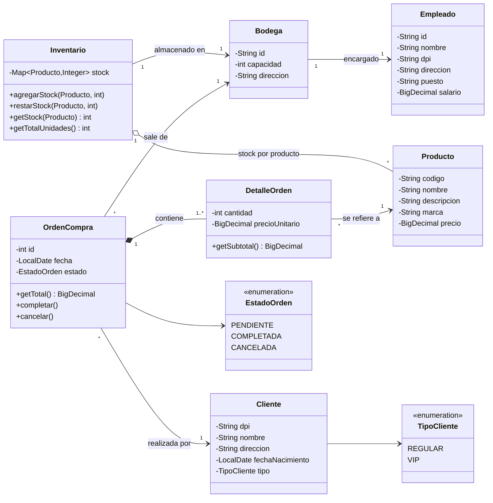
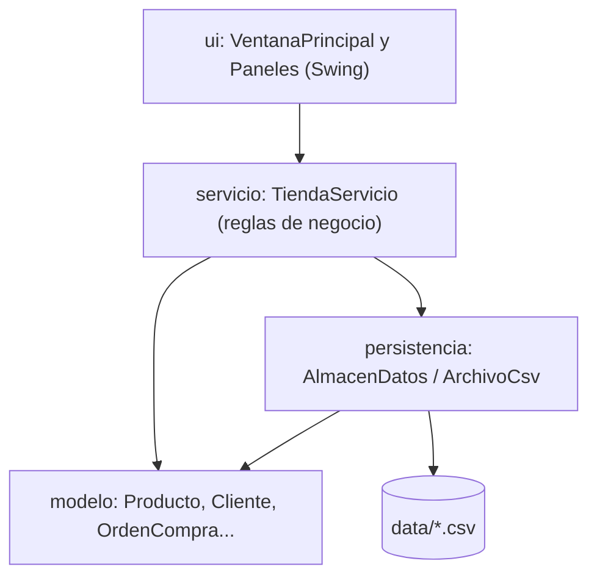
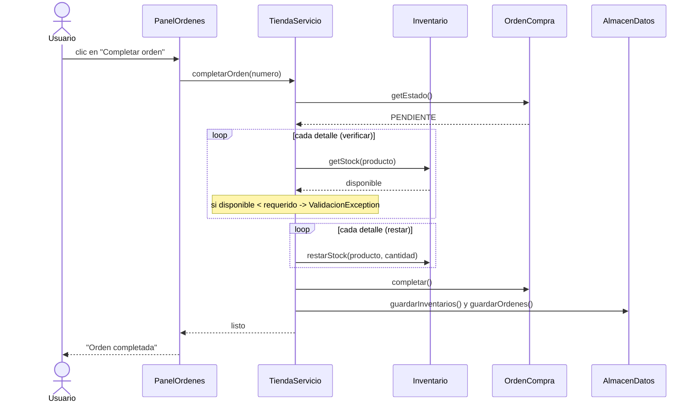
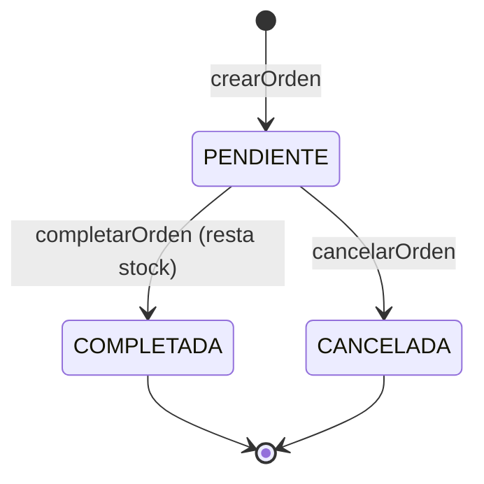

# Diagramas UML
## 1. Diagrama de clases (modelo del dominio)

Muestra las seis entidades del enunciado y cómo se relacionan.

**Cómo leerlo**

- `-->` asociación (un objeto conoce a otro).
- `o--` agregación (el inventario *tiene* productos, pero los productos existen sin él).
- `*--` composición (los detalles no existen sin su orden).
- `"1..*"` significa "uno o más": la orden **siempre** tiene al menos un detalle.

## 2. Diagrama de capas (arquitectura)

Regla de oro: **cada capa solo habla con la de abajo**. La interfaz nunca toca archivos
y el modelo no sabe que existen ventanas ni archivos.

## 3. Diagrama de secuencia: completar una orden

## 4. Estados de una orden

